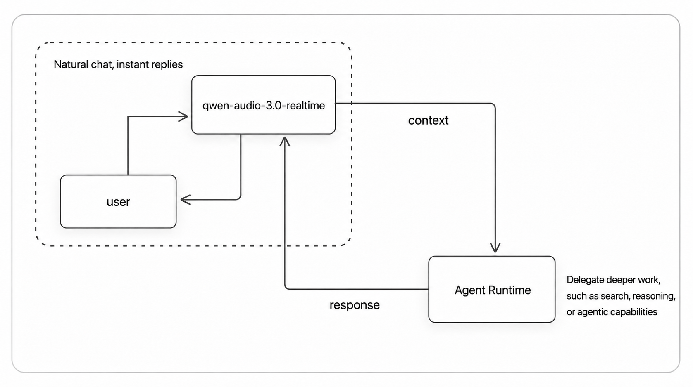
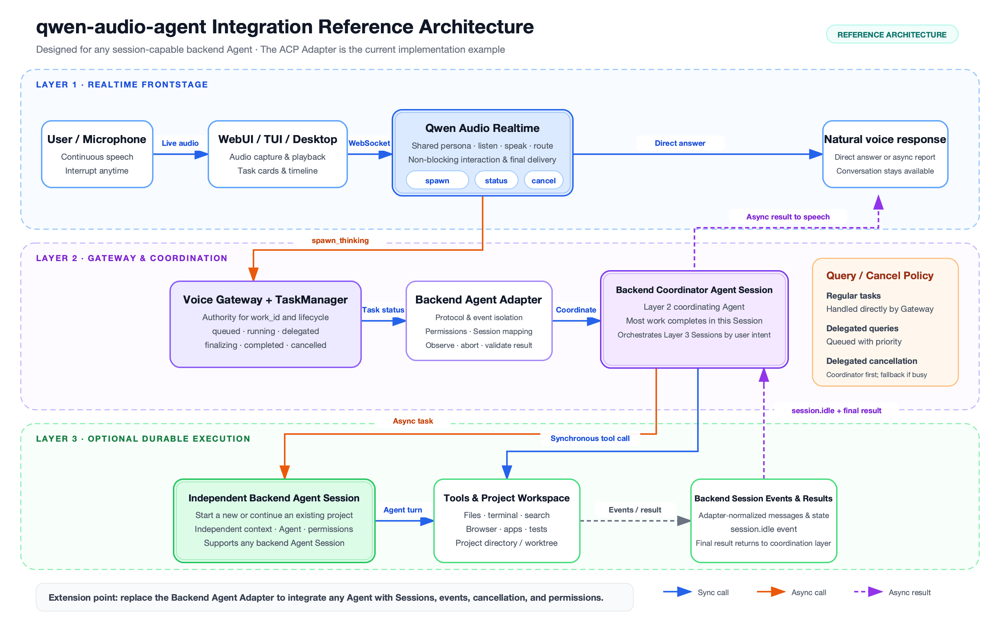
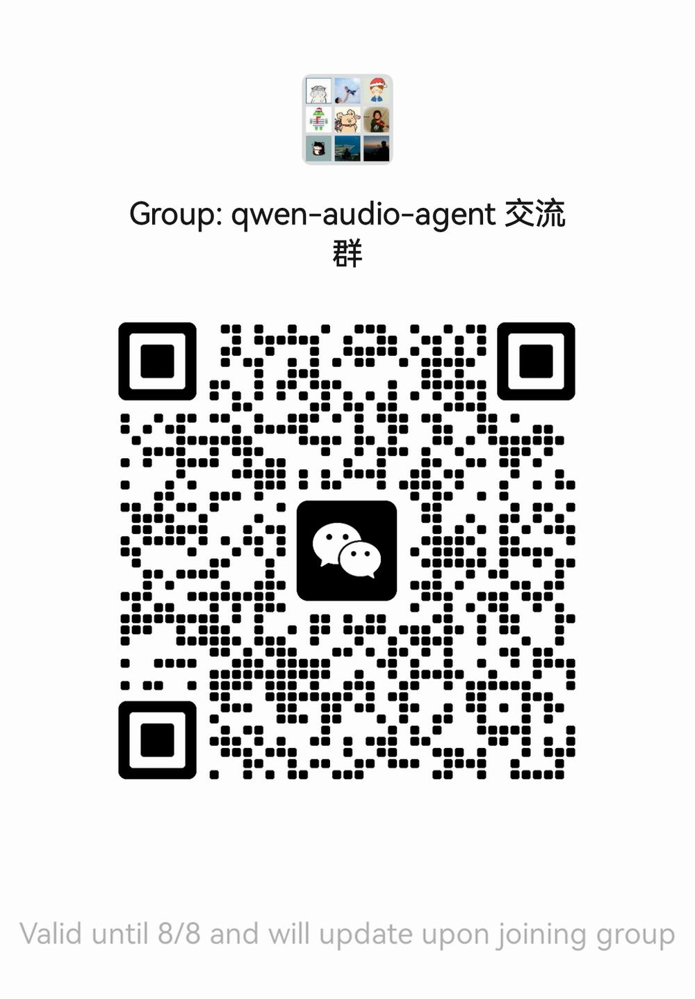

> **[中文化] qwen-audio-agent**
>
> 此项目是 [QwenAudio/qwen-audio-agent](https://github.com/QwenAudio/qwen-audio-agent) 的中文翻译版本。
> - 原项目 Stars: 2385
> - 主语言: JavaScript
> - 许可证: Apache-2.0
> - 翻译日期: 2026-09-10
> - 原始 README: [README_en.md](README_en.md)
>
> 如有翻译不准确之处，欢迎提 Issue 或 PR。

---


---

# Qwen 音频代理

[中文](README_ZH.md) | [English](README.md) | [用户指南](https://qwenaudio.github.io/qwen-audio-agent/) | [快速开始](https://qwenaudio.github.io/qwen-audio-agent/getting-started/quickstart)

[](https://github.com/QwenAudio/qwen-audio-agent/actions/workflows/ci.yml)
[](https://www.npmjs.com/package/qwen-audio-agent)
[](https://nodejs.org/)
[](LICENSE)
[](#community)

## 代理在场感

真正的对话不应在说完一句话后就让你干等，也不应因为代理正在查资料、调用工具或处理任务而陷入停滞。

对话应持续进行，代理应始终在场。

这正是我们构建 **qwen-audio-agent** 的原因——一个实时语音运行时，让代理持续对话、工作并保持在场。无论是与你聊天、思考问题还是处理任务，你的代理始终留在对话中。它倾听、回应，并在任务完成时自然地告诉你：

“准备好了。”

## 新闻动态

- **2026-08-27 · v2.0.0（开发中）**
  🚧 下一个主版本正在积极开发中，正在进行代理架构、任务生命周期、多模态输入、记忆和可扩展性方面的工作。
- **2026-08-20 · [v1.11.0](https://github.com/QwenAudio/qwen-audio-agent/releases/tag/v1.11.0)**
  🧩 新增可嵌入的 Gateway 和 Realtime Provider 扩展；🛠️ 支持安装和管理代理技能；📎 为 TUI 增加多模态输入；🎨 将宠物动画关联到运行时状态。
- **2026-08-13 · [v1.9.0](https://github.com/QwenAudio/qwen-audio-agent/releases/tag/v1.9.0)**
  🧩 桌面任务卡片显示代理实时进度；🔎 后端代理选择更清晰且可搜索；🎙️ 支持 Qwen3.5-Omni Realtime 前端集成。
- **2026-08-07 · [v1.7.0](https://github.com/QwenAudio/qwen-audio-agent/releases/tag/v1.7.0)**
  🎨 球体支持自定义皮肤——导入你自己的外观，兼容 [Awesome Codex Pet](https://codexpet.top/) 社区画廊的宠物包；🪟 改进了 Windows 后端代理启动。
- **2026-08-05 · [v1.5.0](https://github.com/QwenAudio/qwen-audio-agent/releases/tag/v1.5.0)**
  ⏰ 新增定时提醒和进度报告；🗣️ 新增语音唤醒词（“你好千问”）；🐧 支持 Linux 桌面构建；桌面应用现在使用与 CLI 隔离的数据目录。
- **2026-08-03 · [v1.3.0](https://github.com/QwenAudio/qwen-audio-agent/releases/tag/v1.3.0)**
  🎙️ 新增 [🤗 speech-to-speech](https://github.com/huggingface/speech-to-speech) 前端集成，支持完全本地的 VAD、STT、LLM 和 TTS。
- **2026-07-30 · [v1.0.0](https://github.com/QwenAudio/qwen-audio-agent/releases/tag/v1.0.0)**
  🚀 首个稳定版本，推出内置 Gateway 的 macOS 桌面应用。
- **2026-07-28 · [v0.9.0](https://github.com/QwenAudio/qwen-audio-agent/releases/tag/v0.9.0)**
  🌍 项目正式开源；后端代理统一采用 ACP 架构。

## 对话持续，任务并行

对话不会因后台任务而中断；当任务完成时，结果自然返回当前对话：

https://github.com/user-attachments/assets/ab570531-8da9-4af4-93fa-244bb6614c05

### 核心特性

- 全双工实时语音交互，支持自然打断和持续多轮对话
- 一键集成你偏好的代理，复用其模型配置、工具、MCP、技能和认证
- 前端对话与后台任务并行运行；可随时询问进度或取消任务
- 创建多个独立任务，由后端代理异步执行，持续跟踪状态
- 任务结果自动返回当前对话，支持追问和修改
- WebUI、终端 TUI 和桌面悬浮球（macOS / Windows / Linux）
- 长期按用户个性化记忆，可选 VoiceMem 连接器

## 架构



可以直接回答的问题会立即回答；当需要工具或持续处理时，任务会委派给后端代理。在整个过程中，用户始终面对同一个助手。

<details open>
<summary>查看详细架构</summary>



完整设计和模块分解，请参阅[架构文档](docs/architecture/deep-dive.md)。

</details>

## 代理支持

| 后端代理 | 集成方式 | 设置 | 评级 |
| --- | --- | --- | --- |
| 无 | 不适用 | 仅前端模式，无需配置 | ★★★★★ |
| Qwen Code | 原生 ACP | 一键安装，需用户配置 | ★★★★★ |
| OpenCode | 原生 ACP | 一键安装 + 百炼配置 | ★★★★★ |
| OpenClaw | 内置 ACP 桥接 | 一键安装 + 百炼配置 | ★★★★★ |
| Qoder | 原生 ACP | 一键安装，需用户配置 | ★★★★★ |
| MiniMax Code | 原生 ACP | 一键安装，需用户配置 | ★★★★☆ |
| Kimi Code | 原生 ACP | 一键安装，需用户配置 | ★★★★★ |
| Hermes | 原生 ACP | 一键安装，需用户配置 | ★★★★☆ |
| CodeBuddy | 原生 ACP | 一键安装，需用户配置 | ★★★★☆ |
| Codex | 外部 ACP 适配器 | 一键安装（基础 + 适配器），需用户配置 | ★★★★☆ |
| Claude Code | 外部 ACP 适配器 | 一键安装（基础 + 适配器），需用户配置 | ★★★★☆ |
| DeepSeek | 原生 ACP | 一键安装，需 DeepSeek API 密钥 | ★★★★☆ |
| Pi | 外部 ACP 适配器 | 一键安装（基础 + 适配器），需用户配置 | ★★★★☆ |

评级反映当前集成完整度、兼容性和验证水平：五星表示经过全面测试的推荐集成；四星表示正在积极开发或尚未完全验证。详细配置和功能边界，请参阅[后端代理文档](docs/backends/overview.md)和[配置指南](docs/configuration.md)。

## 安装

需要 Node.js 22.22.2+ 或 24.15.0+，npm 10+。一键安装（推荐）：

```bash
npm install -g qwen-audio-agent
```

如需从源码构建、从 GitHub 安装或获取 DashScope API 密钥，请参阅[安装指南](docs/getting-started/install.md)。

## 快速开始

1. 创建配置并填写 API 密钥：

```bash
qwenaudio config
```

```dotenv
DASHSCOPE_API_KEY=你的密钥
# 语音前端模型：Audio Flash/Plus 或 Omni Flash/Plus（默认 Audio Plus）
QWEN_AUDIO_REALTIME_MODEL=qwen-audio-3.0-realtime-plus
# 后端代理：可选，留空或设为 none 以使用仅前端模式
AGENT_PROTOCOL=openclaw
# 后端模型：可选；显式值使用标准 ACP，留空则复用代理配置
QWEN_AUDIO_AGENT_BACKEND_MODEL=qwen3.7-max
```

开始之前，请从[百炼 API 密钥页面](https://bailian.console.aliyun.com/?tab=model#/api-key)创建密钥。
符合条件的新用户可查看[新用户免费额度](https://help.aliyun.com/zh/model-studio/new-free-quota)
并在[模型用量页面](https://help.aliyun.com/zh/model-studio/model-usage-statistics)查看剩余用量。
额度和计费规则以百炼官方最新文档为准。

> 默认使用 DashScope 实时语音。备选方案包括
> [Speech-to-Speech](docs/voice-frontends/speech-to-speech.md) 和
> [ModelBest MiniCPM-o 4.5](docs/voice-frontends/minicpm-o.md)，可通过其服务 URL 选择本地或托管端点。

使用支持视觉的 Realtime 前端时，WebUI 可以在实时音频之外显式流式传输有界摄像头帧。请参阅 [Realtime 前端配置](docs/configuration/frontend.md)。

2. 启动 Gateway，然后在另一个终端启动 TUI（或使用 `qwenaudio webui` 打开浏览器界面）：

```bash
qwenaudio        # 终端 1：Gateway
qwenaudio tui    # 终端 2：TUI
```

完整的配置选项、本地语音前端设置和 TUI 平台说明，请参阅[快速开始](docs/getting-started/quickstart.md)、
[语音前端](docs/configuration/frontend.md)和
[TUI 说明](docs/getting-started/tui.md)。

## 桌面应用

桌面应用提供持久悬浮语音球，内置 Gateway、自动空闲休眠、本地语音唤醒和可自定义外观。
从发布页面下载对应平台的安装程序，或从源码构建：

```bash
npm run desktop:build:local      # macOS
npm run desktop:build:win        # Windows
npm run desktop:build:linux      # Linux（AppImage + deb，无签名）
```

视觉效果、球体行为及构建说明，请参阅[桌面文档](docs/desktop/overview.md)。

## 示例与场景扩展

当前 qwen-audio-agent 框架聚焦于桌面生产力场景：用户可以实时与代理持续对话，同时将工具使用、文件操作、代码修改和长时间运行的任务委派给后端代理。

这种“前台对话 + 后台任务”的设计不仅限于桌面使用，还可以扩展到更多代理既能自然聊天又能实际完成工作的场景。

| 场景 | 描述 | 链接 | 状态 |
| --- | --- | --- | --- |
| 桌面 | 语音聊天、进度追问、工具和后台任务。 | [文档][desktop-docs] | 可用 |
| 智能座舱 | 车辆控制、导航、音乐、天气和服务。 | [示例][smart-cockpit-example] | 可用 |
| VoiceMem | 可选的语义记忆，支持转录文本或原生音频输入。 | [设置示例][voicemem-example] | 可用 |
| LightRAG | 可替换的知识库，支持语义检索、文档索引和管理。 | [集成示例][lightrag-example] | 可用 |
| 客户支持 | 问题澄清、订单查询、工单和人工转接。 | 待定 | 规划中 |
| 具身智能 | 语音指令、动作执行、巡检和异常反馈。 | 待定 | 规划中 |
| 直播助手 | 观众互动、商品讲解、优惠券和风险提醒。 | 待定 | 探索中 |

本仓库包含一个基于前台对话与后台执行边界的智能座舱参考场景。其座舱 UI、小型 A2A 代理和座舱服务均为可替换的客户示例：

```bash
cp examples/smart-cockpit/.env.example examples/smart-cockpit/.env.local
npm run example:smart-cockpit:install
npm run example:smart-cockpit          # 服务 + 代理 + gateway + 客户端
```

详见 [examples/smart-cockpit](https://github.com/QwenAudio/qwen-audio-agent/tree/main/examples/smart-cockpit)。

[VoiceMem 设置示例](https://github.com/QwenAudio/qwen-audio-agent/tree/main/examples/voicemem)
展示了如何在框架之外安装 VoiceMem、配置连接器，并在 Realtime 转录文本和 VoiceMem 原生音频之间切换。轻量级 Markdown 记忆仍为默认；核心 npm 包不包含 VoiceMem Python 代码或依赖。

[LightRAG 集成示例](https://github.com/QwenAudio/qwen-audio-agent/tree/main/examples/lightrag)
通过通用 `KnowledgeProvider` 连接独立部署的知识库。LightRAG 保留对其 LLM、嵌入、文档和索引的控制；核心 npm 包不包含 LightRAG 或 Python 依赖。

[desktop-docs]: docs/desktop/overview.md
[smart-cockpit-example]: examples/smart-cockpit
[voicemem-example]: https://github.com/QwenAudio/qwen-audio-agent/tree/main/examples/voicemem
[lightrag-example]: https://github.com/QwenAudio/qwen-audio-agent/tree/main/examples/lightrag

## 社区

你可以直接在 [GitHub Issues](https://github.com/QwenAudio/qwen-audio-agent/issues) 中发起讨论。

中国用户可扫描下方二维码加入微信群。如果群二维码已满或过期，请扫描任一维护者的个人二维码以获取邀请。

| 微信群 | 个人 | 个人 |
| :---: | :---: | :---: |
|  |  |  |

## 贡献与安全

- 开发与贡献指南：[CONTRIBUTING.md](CONTRIBUTING.md)
- 安全报告：[SECURITY.md](SECURITY.md)
- 数据流与隐私：[PRIVACY.md](PRIVACY.md)
- 第三方声明：[THIRD_PARTY_NOTICES.md](THIRD_PARTY_NOTICES.md)

## 许可证

[Apache License 2.0](LICENSE)