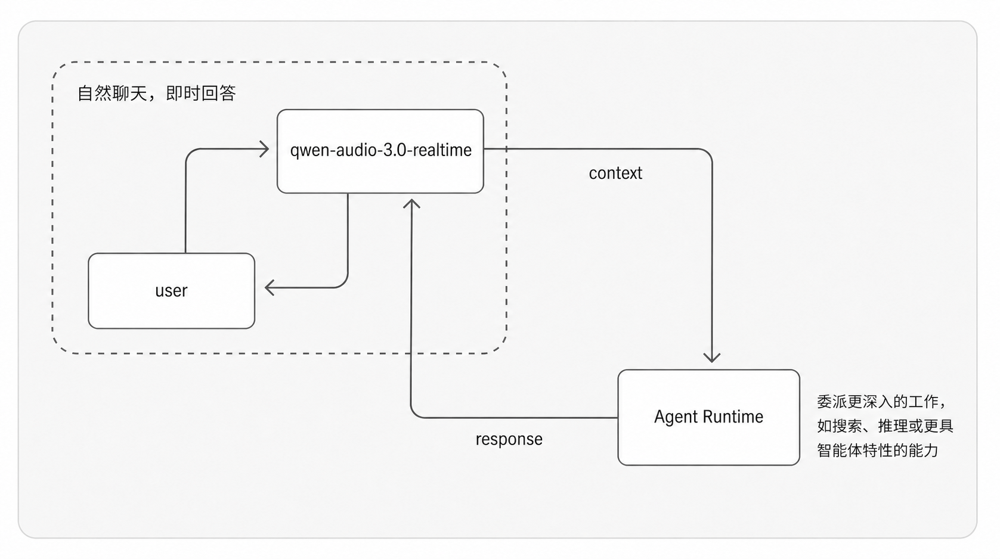
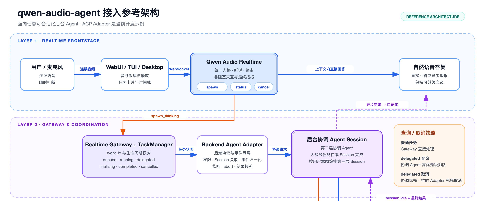

<!-- _class: lead -->

# 面向持续对话与长时任务的语音 Agent 架构

## qwen-audio-agent 架构设计

低延迟对话 · 异步工作 · 独立执行 · 自然播报 · 长期记忆

---

<!-- _class: diagram -->

# 系统总览：实时语音与后台 Agent 协同



<!--
[Sources]
- docs/architecture-overview.png
-->

---

# 框架目标：统一实时交互与长时任务执行

> 系统向用户呈现为一个持续在线的语音 Agent：前台保持对话，后台承担长时工作。

- 可即时响应的问题：直接回答，并支持随时打断。
- 复杂任务：交给后台，可能运行几分钟甚至更久。
- 等待期间：用户可以继续说话、查询进度或取消任务。
- 任务完成：结果回到同一个语音人格，自然地接上当前对话。

<p class="callout">核心目标：让“实时交谈”和“长期工作”同时成立。</p>

---

# 一个助手，运行在两种时间尺度上

<div class="two-col">

<div>

<p class="big-number">百毫秒级</p>

### 对话节奏

- 低延迟
- 可打断
- 持续在场

<p class="plain-term">实时路径目标：低延迟响应。</p>

</div>

<div>

<p class="big-number">秒~小时级</p>

### 工作节奏

- 工具与文件
- 多个工作会话
- 可恢复、可取消

<p class="plain-term">异步路径目标：可靠执行与恢复。</p>

</div>

</div>

---

<!-- _class: diagram -->

# 两级运行架构：实时前台与后台协调



<!--
[Sources]
- docs/qwen-audio-agent-two-layer-architecture.png
-->

---

# 两级架构划分为六个职责域

| 职责域 | 组件 | 架构职责 |
| --- | --- | --- |
| 实时对话 | Realtime Frontstage | 理解对话、决定直接回答或提交异步任务，承接后台结果 |
| 语音控制 | Realtime Gateway | 管理客户端接入（GCP）、语音连接、回合、打断、Realtime 协议、响应关联与播放状态 |
| 任务账本 | TaskManager | 记录任务是否排队、运行、完成或取消 |
| 后台接入 | BackendPort / Adapter | 将 ACP、A2A 与自定义后台 Agent 归一为统一事件与状态 |
| 持续协调 | Coordinator Session | 维持用户上下文，决定直接完成或继续委派 |
| 结果播报 | AnnouncementManager | 等到合适时机，再让前台自然说出结果 |

**具体实现可以替换，职责边界必须保持稳定。**

---

# 一次后台任务经历判断、受理、执行与交付

<div class="runtime-pipeline">
  <div class="runtime-step">
    <strong>前台判断</strong>
    <span class="component">Realtime Frontstage</span>
    <span class="action">直接回答或转入后台</span>
  </div>
  <div class="runtime-arrow">→</div>
  <div class="runtime-step">
    <strong>任务受理</strong>
    <span class="component">TaskManager</span>
    <span class="action">建立任务并持续跟踪</span>
  </div>
  <div class="runtime-arrow">→</div>
  <div class="runtime-step">
    <strong>后台执行</strong>
    <span class="component">Backend Adapter<br>+ Coordinator Session</span>
    <span class="action">协调并持续处理</span>
  </div>
  <div class="runtime-arrow">→</div>
  <div class="runtime-step">
    <strong>结果交付</strong>
    <span class="component">AnnouncementManager</span>
    <span class="action">择机交给前台播报</span>
  </div>
</div>

> <strong>Gateway 服务统一承载并编排任务链路：</strong> Realtime Gateway 维护语音交互状态；TaskManager、后台协调器与 AnnouncementManager 分别负责受理、执行和交付。

---

# 实时前台只保留低延迟职责

<div class="two-col">

<div>

## 直接回答

- 当前上下文已经足够
- 不需要外部搜索或文件
- 在当前语音回合生成答案
- 用户可以随时打断

</div>

<div>

## 提交后台

- 需要搜索、工具或文件
- 通过 `spawn_thinking` 提交异步任务
- 得到任务编号后结束本轮
- 后台独立继续执行

</div>

</div>

> 前台不持有后台原生 Session，也不决定后台工具链。

---

# 工具注册表，让前台能力保持可控

```js
export const frontendToolRegistry = new FrontendToolRegistry([
  { definition: spawnThinkingTool, policy: { repeatHandling: 'handler' } },
  { definition: scheduleReminderTool },
  { definition: getCurrentTimeTool },
  { definition: memoryTool },
  { definition: notesTool },
  { definition: cancelAgentTaskTool },
  { definition: getAgentTaskStatusTool },
  // 能力或客户端动作存在时才提供相应工具
  { definition: webSearchTool,         policy: { requiredCapabilities: […] } },
  { definition: fetchUrlTool,          policy: { requiredCapabilities: […] } },
  { definition: knowledgeTool,         policy: { requiredCapabilities: […] } },
  { definition: recallTool,            policy: { requiredCapabilities: […] } },
  { definition: respondPermissionTool, policy: { requiredCapabilities: […] } },
  { definition: respondAgentInputTool, policy: { requiredCapabilities: […] } },
  { definition: enterSleepTool,        policy: { requiredClientActions: […] } },
])
```

> <strong>前台工具集保持最小且有界：</strong> 仅声明实际生效的策略；注册后仍按配置和当前能力筛选，不靠分类标签决定执行方式。

<!--
[Sources]
- server/src/voice/frontend-tools.mjs
- server/src/voice/tools/spawn-thinking-tool.mjs
-->

---

# `spawn_thinking` ：快速受理，不等待结果

> **`spawn_thinking`** 是实时前台提交异步任务的唯一入口：Gateway 写入权威任务记录并立即返回内部受理回执，后台任务继续独立执行。

| 步骤 | 系统做什么 | 用户得到什么 |
| ---: | --- | --- |
| 1 | 保留目标和约束 | 请求不会被改写成另一件事 |
| 2 | 检查后台是否已配置、权限是否待处理 | 明确失败原因，不假装成功 |
| 3 | 写入一个权威任务记录 | 产生唯一任务 ID（`task_N`） |
| 4 | 立即返回受理回执 | 可以继续下一轮对话 |
| 5 | 后台独立取得调度槽并执行 | 不占用实时语音回合 |

```text
accepted 只表示“任务已经进入系统”
不表示“任务已经完成”
```

> 除 `objective` 外，任务还可携带 `input_refs`：把本轮或此前轮次标注为“可引用输入”的图片、文件作为原生附件一并移交后台。


---

# 自包含指令承载前后台之间的任务交接

Gateway 内部保留两份信息：

| 字段 | 含义 | 为什么需要 |
| --- | --- | --- |
| 用户原话 | 用户本轮最终表达 | 作为内部事实依据，避免转述丢失细节 |
| `objective` | 前台整理后的执行目标 | 解析指代并形成自包含任务边界 |

示例：

```text
用户原话：“接着刚才那个页面，把登录失败的问题修掉，不要修改现有视觉。”

objective: “继续当前页面工作，修复登录失败问题；保持现有视觉不变。”
```

**整理目标帮助理解，但永远不覆盖用户原话。**

---

# 协调信息：结构留在 Gateway，后台只收自然指令

用户本轮说：“接着刚才那个页面，把登录失败的问题修掉，不要修改现有视觉。”

```text
① 前台发起工具调用
spawn_thinking({ objective: "继续当前页面工作，修复登录失败问题；保持现有视觉不变。" })

② Gateway 写入权威任务：身份、会话、路由分字段存放，不进 prompt
{ id: "task_12", status: "queued", scope: "user", kind: "work",
  objective: "继续当前页面工作，…", ownerId: "personal", sessionId: "main", turnId: "…" }

③ 后台协调会话实际收到
objective 文本 + COORDINATOR_STABLE_INSTRUCTIONS 稳定指令块 + 用户原话（ACP ContentBlock 附件）
```

> 协调信息**内化为 Gateway 的权威任务记录**；投递给后台的只是投影——前台人格、完整记忆与聊天历史不会被批量转发，稳定指令块同时承载 Project Session 的路由纪律。

<!--
[Sources]
- server/src/task/task-manager.mjs
- server/src/backend/backend-work-input.mjs
- server/src/agent/acp/coordinator-contract.mjs
- server/src/agent/acp/coordinator-instructions.mjs
-->

---

# TaskManager 维护任务生命周期的权威事实